# VentureSeed Capital Networks
### Enterprise Digital Capital Campaign & Micro-Contribution Management Engine

[](https://spring.io/projects/spring-boot)
[](https://spring.io/projects/spring-cloud)
[](https://openjdk.org/)
[](https://github.com/Netflix/eureka)
[](https://spring.io/projects/spring-cloud-gateway)
[](https://jwt.io)

---

## 1. Executive Summary

**VentureSeed Capital Networks** is a high-scale crowdfunding orchestration platform engineered to empower startups, individual innovators, and non-profits to host digital capital campaigns, process backer financial micro-contributions, and track funding milestones in real time.

Built on an enterprise-grade **Spring Cloud Microservices Architecture**, VentureSeed guarantees high resilience, independent service lifecycle management, centralized ingress security via JWT, dynamic load balancing during viral campaigns, and idempotent payment settlement.

---

## 2. Microservices Architecture Topology

```
                              [ Backer / Creator Web Clients ]
                                             │
                                             │ HTTPS / JWT Auth
                                             ▼
                             ┌───────────────────────────────┐
                             │       Ingress Gateway         │
                             │     Spring Cloud Gateway      │
                             │         Port: 8080            │
                             │  (JWT Filter, CORS, LoadBal)  │
                             └───────────────┬───────────────┘
                                             │
             ┌───────────────────────────────┼───────────────────────────────┐
             │                               │                               │
             ▼                               ▼                               ▼
┌─────────────────────────┐     ┌─────────────────────────┐     ┌─────────────────────────┐
│      Auth Service       │     │    Campaign Service     │     │  Contribution Service   │
│       Port: 8081        │     │       Port: 8082        │     │       Port: 8083        │
│   (JWT, BCrypt, Roles)  │     │ (Lifecycle, Goal Metric)│     │  (Pipeline Coordinator) │
└─────────────────────────┘     └────────────▲────────────┘     └────────────┬────────────┘
                                             │                               │
                                             │    OpenFeign Inter-Service    │
                                             ├───────────────────────────────┤
                                             │                               │
                                             │                               ▼
                                             │                  ┌─────────────────────────┐
                                             └──────────────────┤     Payment Service     │
                                                                │       Port: 8084        │
                                                                │ (Idempotent Processor)  │
                                                                └─────────────────────────┘
                                             ▲
                                             │ Service Registration & Health Heartbeats
                                             │
                                ┌─────────────────────────┐
                                │  Eureka Registry Server │
                                │       Port: 8761        │
                                └─────────────────────────┘
```

---

## 3. Microservice Specifications & Port Matrix

| Service | Port | Technology Stack | Primary Responsibilities |
| :--- | :--- | :--- | :--- |
| **`eureka-server`** | `8761` | Netflix Eureka Server, Spring Cloud | Service discovery registry, heartbeats, cluster instance locator. |
| **`api-gateway`** | `8080` | Spring Cloud Gateway, Reactive WebFlux | Centralized ingress routing (`lb://...`), JWT authentication filter, header claim decoration (`X-User-Id`, `X-User-Role`), CORS. |
| **`auth-service`** | `8081` | Spring Security 6, JJWT 0.12.6, H2/JPA | User registration, password hashing (BCrypt), JWT issuance and token validation, role management (`ROLE_CREATOR`, `ROLE_BACKER`). |
| **`campaign-service`**| `8082` | Spring Web, Spring Data JPA, H2 | Campaign lifecycle management (`DRAFT`, `ACTIVE`, `FUNDED`, `EXPIRED`), goal progress calculations, days remaining countdown, aggregate platform metrics. |
| **`contribution-service`** | `8083` | Spring Cloud OpenFeign, LoadBalancer | Inter-service orchestration pipeline, backer contribution ledgers, campaign funding updates, backer pledge history. |
| **`payment-service`** | `8084` | Spring Web, Spring Data JPA, H2 | Idempotent payment orchestration (`txn_...`), multiple payment rails (Credit Card, USDC Crypto, Wire, Digital Wallet), creator fund disbursements. |
| **`web-dashboard`** | `3000` | Vanilla HTML5, Modern CSS, Node HTTP | High-end interactive UI, live contribution stream, real-time progress bars, embedded REST API playground, architecture topology viewer. |

---

## 4. Inter-Service Communication Flow: Contribution Pipeline

When a financial backer submits a micro-contribution, the system executes an atomic 4-step pipeline:

```mermaid
sequenceDiagram
    autonumber
    actor Backer as Backer (Client UI)
    participant Gateway as API Gateway (:8080)
    participant Auth as Auth Service (:8081)
    participant Contrib as Contribution Service (:8083)
    participant Campaign as Campaign Service (:8082)
    participant Payment as Payment Service (:8084)

    Backer->>Gateway: POST /api/contributions (Bearer JWT)
    Note over Gateway: JwtAuthenticationFilter validates signature,<br/>extracts X-User-Id and X-User-Role
    Gateway->>Contrib: Forward validated request

    rect rgb(30, 41, 59)
    Note over Contrib: [Step 1] Validate Campaign Eligibility
    Contrib->>Campaign: OpenFeign: GET /api/campaigns/{id}/validate-active
    Campaign-->>Contrib: Return { active: true, campaignId: 1 }
    end

    rect rgb(30, 41, 59)
    Note over Contrib: [Step 2] Charge Payment Processor
    Contrib->>Payment: OpenFeign: POST /api/payments/charge (Idempotency Key)
    Payment-->>Contrib: Return PaymentResponse (txn_..., status: SUCCESS)
    end

    rect rgb(30, 41, 59)
    Note over Contrib: [Step 3] Update Campaign Goal Progress
    Contrib->>Campaign: OpenFeign: POST /api/campaigns/{id}/contribute-internal
    Note over Campaign: Increment currentAmount & backerCount.<br/>If currentAmount >= goalAmount -> status: FUNDED
    Campaign-->>Contrib: Return updated CampaignDto
    end

    Note over Contrib: [Step 4] Persist Contribution in Ledger
    Contrib-->>Gateway: Return ContributionResponse (status: COMPLETED)
    Gateway-->>Backer: 201 Created JSON Payload
```



---

## 5. Security & Authentication Architecture

1. **Stateless JWT Tokens**: Tokens are generated by `auth-service` using HMAC-SHA256 (`Keys.hmacShaKeyFor`) with embedded claims:
   - `userId`: Numeric identifier
   - `email`: Principal email address
   - `role`: `ROLE_CREATOR` or `ROLE_BACKER`
   - `exp`: 24-hour expiration window
2. **Centralized Ingress Filter**: The `api-gateway` intercepts all inbound requests.
   - Public paths (`/api/auth/**`, `GET /api/campaigns/**`) bypass validation.
   - Secured paths (`POST /api/campaigns`, `POST /api/contributions`, `POST /api/payments/disburse`) require a valid `Authorization: Bearer <token>` header.
   - The gateway decodes the claims and injects HTTP headers `X-User-Id`, `X-User-Email`, and `X-User-Role` downstream.

### Pre-Seeded Test Personas
The system includes seeded accounts ready for immediate testing:

| Email | Password | Role | Persona Description |
| :--- | :--- | :--- | :--- |
| `creator@ventureseed.com` | `password123` | `ROLE_CREATOR` | Elena Rostova - Campaign Creator |
| `backer@ventureseed.com` | `password123` | `ROLE_BACKER` | David Vance - Financial Backer |
| `founder@quantumleaf.io` | `password123` | `ROLE_CREATOR` | Dr. Aris Thorne - DeepTech Founder |
| `investor@summitcapital.com`| `password123` | `ROLE_BACKER` | Sophia Chen - Angel Investor |

---

## 6. Comprehensive REST API Reference

All requests can be sent through the **API Gateway** on port `8080`.

### 6.1 Authentication (`/api/auth`)

#### User Login
```bash
curl -X POST http://localhost:8080/api/auth/login \
  -H "Content-Type: application/json" \
  -d '{
    "email": "backer@ventureseed.com",
    "password": "password123"
  }'
```
**Response (200 OK):**
```json
{
  "token": "eyJhbGciOiJIUzI1NiJ9...",
  "type": "Bearer",
  "id": 2,
  "fullName": "David Vance",
  "email": "backer@ventureseed.com",
  "role": "ROLE_BACKER"
}
```

#### User Registration
```bash
curl -X POST http://localhost:8080/api/auth/register \
  -H "Content-Type: application/json" \
  -d '{
    "fullName": "Marcus Brody",
    "email": "marcus@venturecapital.com",
    "password": "securePassword123",
    "role": "ROLE_BACKER"
  }'
```

---

### 6.2 Campaigns (`/api/campaigns`)

#### Get Platform Metrics
```bash
curl -X GET http://localhost:8080/api/campaigns/metrics
```
**Response (200 OK):**
```json
{
  "totalRaised": 271550.00,
  "totalCampaigns": 4,
  "activeCampaigns": 3,
  "fundedCampaigns": 1,
  "totalBackers": 756
}
```

#### List Campaigns
```bash
# Filter by category or status
curl -X GET "http://localhost:8080/api/campaigns?status=ACTIVE&category=CLEAN_ENERGY"
```

#### Create Campaign (Requires `ROLE_CREATOR` JWT)
```bash
curl -X POST http://localhost:8080/api/campaigns \
  -H "Content-Type: application/json" \
  -H "Authorization: Bearer <CREATOR_JWT_TOKEN>" \
  -d '{
    "title": "BioNano Water Desalination",
    "tagline": "Graphene membrane desalination with zero emissions",
    "description": "Low-pressure biomimetic water purification filters providing clean municipal water.",
    "category": "CLEAN_ENERGY",
    "goalAmount": 60000.00,
    "creatorId": 1,
    "creatorName": "Elena Rostova",
    "creatorEmail": "creator@ventureseed.com",
    "deadline": "2026-12-31",
    "imageUrl": "https://images.unsplash.com/photo-1509391365360-2e959784a276"
  }'
```

---

### 6.3 Contributions (`/api/contributions`)

#### Make a Micro-Contribution (Triggers Feign Orchestration)
```bash
curl -X POST http://localhost:8080/api/contributions \
  -H "Content-Type: application/json" \
  -H "Authorization: Bearer <BACKER_JWT_TOKEN>" \
  -d '{
    "campaignId": 1,
    "backerId": 2,
    "backerName": "David Vance",
    "backerEmail": "backer@ventureseed.com",
    "amount": 250.00,
    "paymentMethod": "CREDIT_CARD",
    "message": "Excited for this green hydrogen breakthrough!",
    "idempotencyKey": "contrib_req_uuid_98765"
  }'
```
**Response (201 Created):**
```json
{
  "id": 4,
  "campaignId": 1,
  "backerId": 2,
  "backerName": "David Vance",
  "backerEmail": "backer@ventureseed.com",
  "amount": 250.00,
  "paymentMethod": "CREDIT_CARD",
  "status": "COMPLETED",
  "transactionReference": "txn_8c4f2e9a1b0d4c8e",
  "message": "Excited for this green hydrogen breakthrough!",
  "createdAt": "2026-09-28T00:20:00"
}
```

#### Get Campaign Contributions Feed
```bash
curl -X GET http://localhost:8080/api/contributions/campaign/1
```

---

### 6.4 Payments (`/api/payments`)

#### Process Direct Charge
```bash
curl -X POST http://localhost:8080/api/payments/charge \
  -H "Content-Type: application/json" \
  -d '{
    "campaignId": 1,
    "backerId": 2,
    "amount": 100.00,
    "currency": "USD",
    "paymentMethod": "DIGITAL_WALLET",
    "idempotencyKey": "idemp_charge_12345"
  }'
```

#### Disburse Funds to Campaign Creator
```bash
curl -X POST http://localhost:8080/api/payments/disburse \
  -H "Content-Type: application/json" \
  -H "Authorization: Bearer <CREATOR_JWT_TOKEN>" \
  -d '{
    "campaignId": 2,
    "creatorId": 1,
    "amount": 150000.00,
    "destinationAccount": "US-BANK-ROUTING-7890123"
  }'
```

---

## 7. How to Run the Project

### Option A: Quick Interactive Web Dashboard (Instant Run)
You can launch and explore the complete interactive frontend UI with live microservice simulators and API testing right away:
```powershell
# From the root directory:
cd web-dashboard
node server.js
```
Open **[http://localhost:3000](http://localhost:3000)** in your browser!

Or simply double-click **`start-all.bat`** and select **`[2] Start Web Dashboard Only`**.

---

### Option B: Build and Run Spring Boot Microservices (Local Java 21)
The repository includes a portable Maven Wrapper (`mvnw.cmd` and `mvnw`) that automatically configures Apache Maven:

1. **Compile and Package all microservices:**
   ```powershell
   .\mvnw.cmd clean package -DskipTests
   ```
2. **Start the complete mesh:**
   ```powershell
   .\start-all.ps1
   ```
   This will boot the services in their proper dependency sequence:
   - Eureka Server on port `8761`
   - Auth Service on port `8081`
   - Campaign Service on port `8082`
   - Payment Service on port `8084`
   - Contribution Service on port `8083`
   - API Gateway on port `8080`
   - Web Dashboard on port `3000`

---

### Option C: Containerized Deployment (Docker Compose)
To spin up all microservices in lightweight Alpine containers:
```bash
docker-compose up --build
```
Access points:
- **Web Dashboard**: `http://localhost:3000`
- **API Gateway Ingress**: `http://localhost:8080`
- **Eureka Service Registry**: `http://localhost:8761`

---

## 8. Running Automated Unit & Integration Tests

Execute unit tests and MockMvc integration tests across all microservices:
```powershell
.\mvnw.cmd test
```
To run tests for an individual module:
```powershell
.\mvnw.cmd test -pl contribution-service
```
Verified test suites include:
- `AuthServiceTest` & `AuthControllerIntegrationTest`: BCrypt hashing, JWT generation, login flows.
- `CampaignServiceTest` & `CampaignControllerIntegrationTest`: Goal metrics, lifecycle state transitions.
- `PaymentServiceTest` & `PaymentControllerIntegrationTest`: Charge idempotency, multi-rail settlement.
- `ContributionServiceTest`: Full OpenFeign mock pipeline (`Contribution -> Campaign -> Payment`).

---

## 9. License & Attribution
Developed for **VentureSeed Capital Networks** as an enterprise-grade digital capital campaign and micro-contribution orchestration engine.
